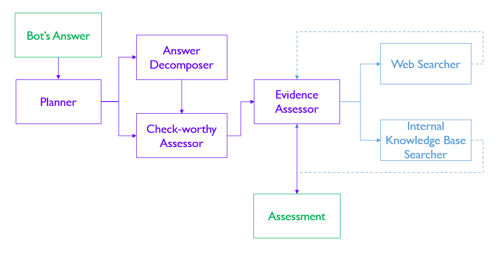

# Example 1: Agentic Fact Checker

This worked example applies the [four steps for AI developers](../for-ai-developers.md) to one system.

Fact-checking is a time-consuming process requiring deep analysis of claims, evidence, and their sufficiency. Our colleagues in the AI Practice recently developed an agentic fact-checking system (read their [Agentic AI Primer](https://playbooks.aip.gov.sg/agentic-ai-primer/09_applications_for_singapore_govt/) for details), using a complex multi-agent architecture to validate the veracity of any claim.

## Step 1: Identify Capabilities

Figure 1: Architecture for the Agentic Fact Checker (taken from the Agentic AI Primer)

The Agentic Fact Checker system comprises six distinct agents:

| Agent Type                   | Agent Name            | Task                                                                            |
| ---------------------------- | --------------------- | ------------------------------------------------------------------------------- |
| Core Orchestration           | Planner               | Coordinates overall fact-checking workflow and task distribution                |
| Core Orchestration           | Answer Decomposer     | Breaks down complex statements into verifiable claims                           |
| Verification Agents          | Check-worthy Assessor | Evaluates which claims require fact-checking                                    |
| Verification Agents          | Evidence Assessor     | Synthesises information from multiple sources to make factuality determinations |
| Information Retrieval Agents | Web Searcher          | Accesses external web sources via search APIs                                   |
| Information Retrieval Agents | Internal KB Searcher  | Queries internal knowledge base for relevant information                        |

Based on the capability taxonomy, this system demonstrates:

| Category | Capability | Explanation |
| ----- | ----- | ----- |
| Cognitive   | CAP-01: Planning and Goal Management | The Planner coordinates the workflow and determines whether systematic decomposition is needed. |
| Cognitive   | CAP-02: Agent Delegation | The Planner assigns subtasks to specialized agents (decomposer, assessors, searchers) and coordinates their activities. |
| Cognitive    | CAP-03: Tool Use | The Evidence Assessor evaluates and selects between web search and internal knowledge base tools. |
| Interaction  | CAP-04: Multimodal Understanding and Generation | All agents process text statements; Evidence Assessor generates factuality assessments in natural language. |
| Interaction  | CAP-07: Internet and Search Access | The Web Searcher retrieves up-to-date information from external web sources via search APIs. |
| Operational  | CAP-11: File and Data Management | The Internal KB Searcher queries and accesses internal knowledge bases. |

## Step 2: Evaluate Risks

We identify risks from baseline components and capabilities, assessing likelihood and impact given the fact-checking context. Assuming organisational relevance threshold requires both impact ≥3 AND likelihood ≥3, we identify the following priority risks:

**Priority Risks (Impact ≥3, Likelihood ≥3):**

| Risk ID | Element | Risk Statement | Assessment |
|----------|---------|----------------|------------|
| RISK-002 | CMP-01 (LLM) | Insufficient alignment of LLM behaviour | **[Impact: 4, Likelihood: 4]** LLM misalignment could cause it to ignore safety constraints or misinterpret fact-checking instructions, undermining verification accuracy. |
| RISK-007 | CMP-03 (Tools) | Lack of input sanitisation | **[Impact: 5, Likelihood: 4]** Critical given web search tools. Unsanitized web content from malicious sites could inject prompts to manipulate verification results. |
| RISK-028 | CAP-04 (Multimodal Understanding) | Generation of non-factual or hallucinated content | **[Impact: 5, Likelihood: 4]** Hallucinated "facts" directly undermine the system's core purpose of verifying truthfulness. |
| RISK-034 | CAP-07 (Internet Access) | Prompt injection via malicious websites | **[Impact: 5, Likelihood: 4]** Critical vulnerability given reliance on web sources. Adversarial sites could embed instructions to override verification logic. |
| RISK-035 | CAP-07 (Internet Access) | Unreliable information or websites | **[Impact: 5, Likelihood: 4]** Core risk—retrieving and trusting unreliable sources undermines verification accuracy and could propagate misinformation. |
| RISK-044 | CAP-11 (File & Data Management) | Prompt injection via malicious files or data | **[Impact: 4, Likelihood: 3]** If internal knowledge base contains user-contributed content, malicious data could inject prompts affecting all verification tasks. |
| RISK-047 | Lethal trifecta (combination rule) | Data exfiltration through combined access to untrusted content, sensitive data, and an outbound channel | **[Impact: 5, Likelihood: 3]** Applies because the system both browses the web and reads the internal knowledge base: an injected instruction on a web page could direct the agent to send internal content out through a search query or URL. |

*(Lower-priority risks documented but not shown here for brevity)*

**How the capabilities are used.** Internet and Search Access is read-only by definition. File and Data Management is used at *read*, on the organisation's own knowledge base. The system keeps nothing between sessions and connects to no outside tool servers or agents, so neither conditional component (Memory, Protocols) is present. Its profile is in [`examples/systems/fact-checker.yaml`](https://github.com/govtech-responsibleai/arc-v2-draft/blob/main/examples/systems/fact-checker.yaml).

**Combination check.** The lethal trifecta is *present*: Internet and Search Access supplies untrusted content and an outbound channel, and File and Data Management supplies sensitive data. RISK-047 therefore applies, and CTRL-0097 must be implemented (see RISK-047 below). Oversight within reach is *not present*: no capability lets the agents change what governs them. Agent Delegation is a reminder to list what each of the six agents can do; all of it is already declared.

## Step 3: Implement Controls

<!-- arc:example fact-checker risks=45 level0=28 lethal-trifecta=present oversight-within-reach=not-present -->
This system has 45 applicable risks: 22 baseline, 19 from single capabilities, and four from combinations (RISK-047, plus the multi-agent risks RISK-012, RISK-013 and RISK-051 that Agent Delegation brings in). RISK-041, unintended overwriting or deletion, is left out because the system only reads its knowledge base. Between them the 45 risks carry 28 Level 0 controls. All 28 are implemented as-is and recorded in the assessment; the table below shows the priority risks only — every Level 0 control of each, plus the Level 1 and 2 controls we selected:

| Risk ID | Selected Controls | Implementation |
|---------|-------------------|----------------|
| RISK-002 | **CTRL-0007** (Level 0): Log all LLM inputs and outputs for regular review **CTRL-0038** (Level 0): Conduct safety verification before deployment and on a regular cadence **CTRL-0005** (Level 1): Conduct structured evaluation of multiple LLMs **CTRL-0042** (Level 1): Require explicit human confirmation before executing high-impact or irreversible tool actions | • Log every prompt and completion with the claim ID; sample 5% weekly for review • Run an adversarial test set of manipulated claims and injected sources before each model or prompt change • Evaluated three candidate frontier models on fact-checking benchmarks; selected the one with the strongest instruction-following and refusal behaviour • Require human review before publishing final verification verdicts |
| RISK-007 | **CTRL-0015** (Level 1): Treat all tool metadata and outputs as untrusted input | • Validate all web search results against strict JSON schemas • Sanitize tool outputs before incorporating into agent prompts • Filter tool descriptions for embedded instructions |
| RISK-028 | **CTRL-0048** (Level 2): Implement methods to reduce hallucination rates **CTRL-0049** (Level 0): Implement UI/UX cues for hallucination risk **CTRL-0050** (Level 1): Enable users to verify answers against sources | • Implement RAG using verified knowledge bases to ground responses • Display disclaimers highlighting potential for inaccuracies • Provide inline citations linking to source passages for verification |
| RISK-034 | **CTRL-0060** (Level 1): Implement escape filtering before incorporating web content **CTRL-0061** (Level 1): Use structured retrieval APIs rather than web scraping **CTRL-0062** (Level 0): Implement input guardrails to detect prompt injection | • Sanitize all retrieved web content before adding to prompts • Use Google Search API for structured results rather than raw HTML scraping • Deploy prompt injection detector to scan web content |
| RISK-035 | **CTRL-0063** (Level 1): Prioritise search results from verified, high-quality domains | • Configure search API to prioritise .gov, .edu, and established news sources • Require cross-source validation for claims from unknown domains |
| RISK-044 | **CTRL-0062** (Level 0): Implement input guardrails to detect prompt injection **CTRL-0083** (Level 0): Disallow unknown or external files unless scanned **CTRL-0097** (Level 0): Do not give one agent untrusted content, sensitive data, and an unrestricted outbound channel at once (see RISK-047) | • Validate all new data contributions to knowledge base before ingestion • Scan uploaded files for embedded prompt injection attempts • Maintain allowlist of approved data sources |
| RISK-047 | **CTRL-0089** (Level 0): Enforce default-deny network egress for agent runtimes **CTRL-0097** (Level 0): Do not give one agent untrusted content, sensitive data, and an unrestricted outbound channel at once **CTRL-0090** (Level 1): Enforce data-flow policies with a deterministic policy layer | • Agent runtime may reach only the search API and the internal knowledge base; all other egress is blocked • Search queries are generated by a component that never sees knowledge-base content, so retrieved internal text cannot be smuggled into an outbound query • The combination is broken by splitting the agents: the Web Searcher has no access to the knowledge base and returns only structured fields (source, quotation, date), and the Internal KB Searcher cannot make web requests |

## Step 4: Assess Residual Risks

After implementing controls, key residual risks remain:

| Risk ID | Residual Risk Description | Mitigation Strategy |
|---------|---------------------------|---------------------|
| RISK-034 | **Sophisticated Prompt Injection**: Advanced adversarial websites may craft novel injection attacks that bypass current guardrails and filters. | • Monitor all API calls and agent outputs for anomalous patterns • Regularly update prompt injection detectors with new attack patterns • Establish incident response procedures for detected bypasses |
| RISK-028 | **Cascading Hallucination**: False information generated early in the verification workflow may propagate through subsequent agents, creating systematic verification bias. | • Implement multi-agent cross-checking where independent agents verify claims • Add user feedback mechanisms to flag incorrect verdicts • Compare internal agent reasoning chains to detect inconsistencies |
| RISK-035 | **Domain-Specific Source Assessment**: System may struggle distinguishing authoritative from unreliable sources in highly specialized or emerging domains with limited established references. | • Begin deployment with small-scale pilots in well-defined domains • Validate verification outputs with subject matter experts • Maintain domain-specific allowlists of trusted sources |

These residual risks and mitigation strategies will be reviewed quarterly and updated based on observed system behaviour and emerging threats.
